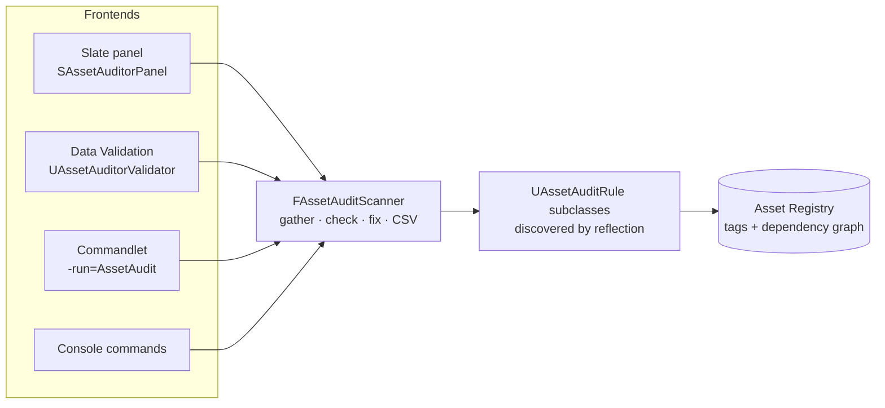

# Asset Auditor for Unreal Engine 5

An editor plugin that finds content problems before they ship and fixes most of them with one click. It scans the project, lists issues in a sortable, filterable table, and runs the same rules through Unreal's Data Validation and a CI commandlet.

**Unreal Engine 5.6 · C++ · Slate · Asset Registry · Data Validation · Commandlets · Automation tests**

| | |
|---|---|
| **Find** | Naming-convention violations, non-power-of-two or oversized textures, meshes missing LODs or simple collision, unreferenced assets |
| **Fix** | One click per issue, or batch-fix a selection. Property fixes are a single Ctrl+Z; renames update every reference |
| **Enforce** | The same rules run on save, from *Validate Assets*, before a source-control submit, and in CI with a pass/fail exit code |
| **Extend** | Adding a rule is one class. It's discovered by reflection and gets its own Project Settings page automatically |

## Quick start

Requirements: Windows, Unreal Engine 5.6, and Visual Studio 2022 with the *Game development with C++* workload.

1. Clone the repo and right-click `ToolsLab.uproject` → **Generate Visual Studio project files**, or build from the command line:
   ```bash
   "C:\Program Files\Epic Games\UE_5.6\Engine\Build\BatchFiles\Build.bat" ToolsLabEditor Win64 Development -Project="<path-to-repo>\ToolsLab.uproject" -WaitMutex
   ```
2. Open `ToolsLab.uproject`, then go to **Tools → Asset Auditor** and click **Scan**.
3. The repo ships with deliberately broken test content in `/Game/AuditTests`. A scan should report **17 issues: 1 error, 9 warnings, 7 info**. To regenerate it from scratch:
   ```bash
   UnrealEditor-Cmd.exe ToolsLab.uproject -run=pythonscript -script="Plugins/AssetAuditor/Scripts/create_test_assets.py"
   ```

To use the plugin in your own project, copy `Plugins/AssetAuditor` into your project's `Plugins/` folder and rebuild. Full usage, settings and the rule-authoring guide are in the **[plugin README](Plugins/AssetAuditor/README.md)**.

## Rules

| Rule | Checks | Fix |
|---|---|---|
| Naming Convention | Type prefixes (`T_`, `SM_`, `M_`, `MI_`, `BP_`, `WBP_`, `ABP_`…), most-specific class wins | Rename through `IAssetTools` |
| Texture Size | Power-of-two sides; size budget (default 2048) | Pad to power of two / clamp Max Texture Size |
| Static Mesh LODs & Collision | LOD count (ignoring tiny and Nanite meshes); simple collision (ignoring *Complex as Simple* and *NoCollision*) | Generate LODs / add box collision |
| Unused Asset | No referencing package (levels and primary assets count as roots) | None, by design |

## Architecture



All four front ends call a single core with no UI, so the editor, save-time validation and CI can never disagree about what counts as a problem.

## Design decisions

- **Rules are abstract `UCLASS`es, not a hand-maintained list.** `GetDerivedClasses` finds them, and `Config=Editor, DefaultConfig` gives each rule its own thresholds in the shared `DefaultEditor.ini`. Each rule's default object is registered with `ISettingsModule`, so every rule gets a Project Settings page without depending on a central settings class.
- **Tags before loads.** Checks read Asset Registry tags (`Dimensions`, `LODs`, `Triangles`, `CollisionPrims`) and load an asset only when the tags can't decide. The texture rule is two-phase: a tag pre-filter, then a load only for suspects whose answer depends on per-asset settings.
- **The caller owns the transaction.** One `FScopedTransaction` per click, and rules call `Modify()`. Mesh fixes reuse the engine's `UStaticMeshEditorSubsystem`, which calls `Modify()` without opening its own transaction. The panel is an `FEditorUndoClient` filtered to this tool's transaction context, so it refreshes on undo and redo.
- **Renames run outside the transaction.** `UObject::Rename` calls `Modify()`, so a recorded rename would let Ctrl+Z move an object back into a package that now holds a redirector, while the files on disk stay renamed. Renames are marked non-undoable and need confirmation.
- **CI is driven by exit codes, not log parsing.** 0 means pass, 1 means issues at or above `-FailOn`, 2 is bad arguments, 3 means the report couldn't be written. Issues are logged at *Display* verbosity so log-scraping CI wrappers don't double-report.

## Engineering notes

Three bugs found during development, each confirmed in the engine source:

1. **Fixed meshes still looked broken.** UE5 builds static meshes asynchronously, and while a mesh compiles, `UStaticMesh::GetAssetRegistryTags` skips its LOD and collision tags. The registry fills the gap with the stale on-disk values. The scanner now calls `FAssetCompilingManager::Get().FinishAllCompilation()` before gathering assets.
2. **Validation used stale tags.** The Data Validation subsystem passes in the registry's on-disk `FAssetData`. The validator rebuilds it from the loaded object, so validate-on-save sees unsaved changes.
3. **Mesh fixes could fail silently.** An editor subsystem only exists once its module is loaded through the module manager; linking against it isn't enough. Mesh fixes now load `StaticMeshEditor` explicitly first.

## Continuous integration

```bash
UnrealEditor-Cmd.exe ToolsLab.uproject -run=AssetAudit -Path=/Game -Report=Saved/AssetAudit/AssetAudit.csv -FailOn=Error -unattended -nosplash
```

Writes a UTF-8 CSV report (severity, rule, asset, class, message, fix) and exits non-zero when issues reach the threshold.

## Tests

Four automation tests cover expected-name logic, CSV escaping, a full scan of the test content (exact issue counts) and the texture fixes:

```bash
UnrealEditor-Cmd.exe ToolsLab.uproject -ExecCmds="Automation RunTests AssetAuditor; Quit" -unattended -nullrhi
```

## Repository layout

```
ToolsLab.uproject                 Host project (blank C++ project)
Plugins/AssetAuditor/
  AssetAuditor.uplugin            Editor-only module, depends on DataValidation
  Source/AssetAuditor/Public/     Rule base class, scanner, settings: the extension API
  Source/AssetAuditor/Private/    Rules, Slate UI, validator, commandlet, tests
  Scripts/create_test_assets.py   Generates the broken test content (pure Python, no art files)
Content/AuditTests/               Generated test content
```

## Roadmap

- Detect unused assets by reachability from roots (maps, primary assets, config), so orphaned *chains* are caught
- Time-sliced scanning for very large projects
- Incremental re-audit driven by Asset Registry events
- Rules authored in Blueprint
